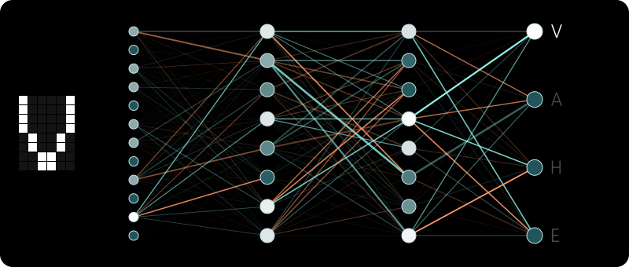

  

<h3 align="center"><i>Visionary ML engineer, experimenting with everything in data science, NLP, computer vision, reinforcement learning and AI agents.</i></h3>

  

  <i>I search for solutions just beyond the frontier, using fundamental knowledge and my own vision of problem solving.</i>

---

## What I Experiment With

| Domain | Playground |
|---|---|
| 🧠 **Data Science** | Feature engineering, statistical modeling, time series analysis, A/B testing, SQL, Power BI |
| 💬 **NLP** | BERT, GPT, vLoRA, JEV, Mixture of Experts (MoE) |
| 👁️ **Computer Vision** | YOLO, MiDaS, recognition, segmentation, vision-language models |
| 🎨 **Generative AI** | Diffusion models, multimodal architectures, generative pipelines |
| 🤖 **AI Agents** | LangChain, LangGraph, LlamaIndex, RAG pipelines, tool-using LLM agents, multi-agent workflows |
| 🎮 **Reinforcement Learning** | Q-learning, multi-armed bandits, Deep Q-Networks (DQN), policy gradients, actor-critic methods |
| ⚙️ **MLOps** | Airflow, MLflow, Docker, ETL pipelines, workflow automation, model deployment |

---

## Toolbox

---

## Let's Connect

